# BAGAN ALIR METODOLOGI PENELITIAN KOMPREHENSIF NUSA-MIPA 2026
**Divisi:** Penambangan Data (*Data Mining*) — DIMAS-TI AMLI 2026 (Universitas Negeri Gorontalo)  
**Judul:** *Spatial-Cluster Mapping, Multiscale Econometric Determinants, and Explainable Domain-Constrained Machine Learning for Educational Numeracy in Indonesia Toward Education 5.0*  
**Format Visual:** Horizontal / Landscape Pipeline (*Left-to-Right*)

---

## 1. Flowchart Diagram (Format Landscape / Horizontal)

```mermaid
graph LR
    %% Styling Configuration
    classDef phase fill:#FFFFFF,stroke:#64748B,stroke-width:1.5px,stroke-dasharray: 4 4,color:#0F172A;
    classDef data fill:#EFF6FF,stroke:#2563EB,stroke-width:2px,color:#1E3A8A;
    classDef eda fill:#F0FDF4,stroke:#16A34A,stroke-width:2px,color:#065F46;
    classDef cluster fill:#FEF3C7,stroke:#D97706,stroke-width:2px,color:#78350F;
    classDef spatial fill:#F5F3FF,stroke:#7C3AED,stroke-width:2px,color:#4C1D95;
    classDef ml fill:#ECFDF5,stroke:#059669,stroke-width:2px,color:#064E3B;
    classDef xai fill:#FFF1F2,stroke:#E11D48,stroke-width:2px,color:#881337;
    classDef sim fill:#F0F9FF,stroke:#0284C7,stroke-width:2px,color:#0C4A6E;

    subgraph P1 ["FASE 1: AKUISISI DATA & AUDIT INTEGRITAS"]
        D1["Dapodik Kemendikbud 2025
        (Sarpras, Pendidik, Rombel, Murid)"]:::data
        D2["Rapor Pendidikan 2025
        (Capaian Numerasi SD-SMP-SMA-SMK)"]:::data
        D3["Survei Lingkungan Belajar 2025
        (Pedagogi D.1, Keamanan, Kebinekaan)"]:::data
        MASTER["Master Dataset Bersih (N=2.056)
        514 Kab/Kota × 4 Jenjang Pendidikan
        0 Missing Value | Koordinat Definitif"]:::data
        D1 --> MASTER
        D2 --> MASTER
        D3 --> MASTER
    end

    subgraph P2 ["FASE 2: SPATIAL EDA & TIPOLOGI IPO"]
        MORAN["Autokorelasi Spasial (Moran's I)
        SD: +0.624 | SMP: +0.549 | SMA: +0.610
        SMK: +0.063 (Vocational Paradox)"]:::eda
        LOSS["Analisis Transisi & Learning Loss
        Rata-rata: SD 53.3 → SMP 63.9 → SMA 57.1
        Drop SMP ke SMA: -6.86 Poin"]:::eda
        CLUST["Clustering K-Means 6 Dimensi IPO
        k=3 (StandardScaler, Silh=0.385, DBI=0.896)
        K1: Benchmark (48.1%) | K2: Paradoks (46.1%)
        K3: Prioritas Afirmasi 3T (5.8%)"]:::cluster
        MASTER --> MORAN
        MASTER --> LOSS
        MASTER --> CLUST
    end

    subgraph P3 ["FASE 3: EKONOMETRIKA SPASIAL MULTISKALA"]
        VIF["Audit Multikolinieritas & VIF
        Eliminasi Singularitas Lokal
        Condition Number: >10^9 → 4.12"]:::spatial
        MGWR["Multiscale GWR (Case 3 & 4)
        Bandwidth Lokal Fleksibel (kj = 35 s.d. 480)
        Composite MGWR: R2 = 0.766, OOF = 0.767
        Residu Moran's I: -0.0109 (Lenyap Total)"]:::spatial
        MORAN --> VIF
        CLUST --> VIF
        VIF --> MGWR
    end

    subgraph P4 ["FASE 4: EXPLAINABLE MACHINE LEARNING"]
        CV["Dual Spatial Cross-Validation
        5-Fold District GroupKFold
        38-Fold Leave-One-Province-Out (LOPO)"]:::ml
        MODELS["Benchmark 11 Algoritma ML
        Extra Trees (R2 = 0.650)
        Random Forest (R2 = 0.642)
        Monotonic LightGBM (R2 = 0.642, LOPO 0.573)"]:::ml
        SHAP["Explainable AI (TreeSHAP)
        Top 1: Kualitas Pembelajaran (+3.24 pt)
        Top 2: Elektrifikasi Sekolah (+1.95 pt)
        3T Paling Sensitif: Keamanan (3.10 pt) & TIK"]:::xai
        MGWR --> CV
        CV --> MODELS
        MODELS --> SHAP
    end

    subgraph P5 ["FASE 5: PRESTASI PRESRIKTIF & PLATFORM"]
        ROBUST["Uji Ketahanan (Robustness Checks)
        Perturbasi Noise ±10% (rho = 0.979)
        Jackknife Subsampling 30% (CV = 3.49%)"]:::ml
        SIMUL["Simulator Preskriptif 'What-If'
        Batas Teoretis Monotonik (Bebas Urban Bias)
        Skenario E: Delta Y = +6.63 pt (97.3% Positif)"]:::sim
        DEPLOY["Platform Web Interaktif NUSA-MIPA
        Choropleth Poligon GeoJSON 514 Daerah
        One-Page District Policy Brief (RKPD)"]:::sim
        MODELS --> ROBUST
        SHAP --> SIMUL
        ROBUST --> SIMUL
        SIMUL --> DEPLOY
    end
```

---

## 2. Deskripsi Tahapan Alur Penelitian

### Fase 1: Akuisisi Data & Audit Integritas Kontrak (Hulu)
1. **Ekstraksi Tiga Sumber Data Resmi Kemendikbudristek 2025**:
   * **Dapodikdasmen 2025**: Data sarana-prasarana (ruang kelas, laboratorium, sanitasi air bersih, elektrifikasi, rasio rombel/ruang, rasio siswa/guru).
   * **Rapor Pendidikan 2025**: Capaian asesmen kompetensi numerasi dan literasi pada 4 jenjang (SD, SMP, SMA, SMK).
   * **Survei Lingkungan Belajar (Sulingjar) 2025**: Kualitas pembelajaran (D.1), refleksi guru (D.2), kepemimpinan instruksional (D.3), iklim keamanan sekolah (D.4), dan indeks kebinekaan (D.8).
2. **Pembersihan & Standardisasi Kontrak**:
   * Menggabungkan data menjadi **Master Dataset 2.056 baris** (514 kabupaten/kota × 4 jenjang).
   * Memisahkan 24 entitas kembar (misal: Kab. Bandung vs Kota Bandung).
   * **0 Missing Values** dan $100\%$ koordinat geografis definitif.

### Fase 2: Spatial Exploratory Data Analysis (EDA) & Tipologi IPO
1. **Pengujian Hukum Tobler Geografi**:
   * Menghitung **Global Moran's I**: SD ($+0.624$), SMP ($+0.549$), SMA ($+0.610$) dengan $p=0.005$. Membuktikan dependensi spasial masif pada jalur pendidikan umum.
   * Mengungkap anomali **Vocational Paradox** pada SMK ($I = +0.063$, sebaran acak independen jarak).
2. **Analisis Transisi & Learning Loss Intra-Daerah**:
   * Mengukur trajektori longitudinal: SD ($53.3$) $\rightarrow$ SMP ($63.9$) $\rightarrow$ SMA ($57.1$) $\rightarrow$ SMK ($55.1$).
   * Mengidentifikasi *severe learning loss* nasional sebesar **$-6.86\text{ poin}$** saat siswa transisi dari SMP ke SMA.
3. **Klasterisasi Tipologi 6 Dimensi IPO**:
   * Evaluasi 215 konfigurasi pengujian klaster ($k=2..5$) $\rightarrow$ terpilih **K-Means ($k=3$, StandardScaler)** dengan Silhouette $0.385$, DBI $0.896$, Calinski-Harabasz $198.4$.
   * Memetakan 3 klaster kebijakan: **Kluster 1 Benchmark** ($n=988$), **Kluster 2 Paradoks Sarpras** ($n=948$), dan **Kluster 3 Prioritas Afirmasi 3T** ($n=120$).

### Fase 3: Ekonometrika Spasial Multiskala (MGWR)
1. **Audit Multikolinieritas Lokal (VIF)**:
   * Mengatasi krisis singularitas numerik model terdahulu (*Condition Number* $>10^9$).
   * Merumuskan 12 tuas kebijakan ortogonal (Case 3 & 4), menekan *Condition Number* lokal hingga **$4.12 - 6.18$**.
2. **Pemodelan MGWR Multiskala**:
   * Menentukan spektrum lebar pita lokal ($k_j$ dari skala lokal $35$ s.d. global $480$ kabupaten).
   * Meraih **$R^2 = 0.766$ (Adj. $R^2 = 0.760$)** dan Spatial Out-of-Fold **$R^2 = 0.767$**.
   * Menghilangkan residu spasial (Moran's I residu turun dari $+0.624$ menjadi **$-0.0109$**). $100\%$ kabupaten kini memiliki variabel determinan lokal yang signifikan ($|t| > 1.96$).

### Fase 4: Explainable Machine Learning (XAI)
1. **Dual Spatial Cross-Validation**:
   * Mencegah kebocoran data spasial (*spatial leakage*) dengan **5-Fold District GroupKFold** dan **38-Fold Leave-One-Province-Out (LOPO)**.
2. **Benchmark 11 Algoritma ML**:
   * Membandingkan OLS, Ridge, Lasso, ElasticNet, SVR, Random Forest, Extra Trees, GBR, XGBoost, CatBoost, dan Monotonic LightGBM.
   * Terpilih **Monotonic LightGBM** (GroupKFold $R^2 = 0.642$, LOPO $R^2 = 0.573$), unggul $+0.14$ di atas regresi linier standar.
3. **Atribusi Tuas Kebijakan (TreeSHAP)**:
   * Menemukan bahwa **Kualitas Pembelajaran (D.1)** adalah tuas nasional terkuat ($+3.24\text{ pt}$), disusul **Elektrifikasi** ($+1.95\text{ pt}$) dan **Sanitasi Air** ($+1.15\text{ pt}$).
   * Wilayah 3T terbukti $4\times$ lebih sensitif terhadap **Iklim Keamanan Sekolah** ($3.10\text{ pt}$) dan **Kebinekaan** ($2.31\text{ pt}$).

### Fase 5: Simulasi Kebijakan Preskriptif & Platform Interaktif (Hilir)
1. **Uji Ketahanan (Robustness Checks)**:
   * Membuktikan stabilitas model melalui perturbasi noise Gaussian $\pm 10\%$ ($\rho = 0.9793$), resampling Jackknife 30% drop ($CV = 3.49\%$), dan sapuan bobot spasial $k$-NN ($k=4..20$).
2. **Simulator Preskriptif "What-If" Domain-Constrained**:
   * Menerapkan batas monotonik pedagogis ($\partial \hat{Y}/\partial X \ge 0$), berhasil **menghapus 100% bias *confounding* perkotaan-perdesaan**.
   * Menguji 5 skenario nyata: Skenario E (Blueprint Terpadu Education 5.0) menghasilkan kenaikan rata-rata nasional **$+6.63\text{ poin}$** ($97.3\%$ unit positif).
3. **Disseminasi & Decision Support System (DSS)**:
   * Menghasilkan **Tabel 7 Rekomendasi Preskriptif 2.056 Unit Observasi**.
   * Mengintegrasikan seluruh temuan ke dalam aplikasi web **NUSA-MIPA Platform** dengan peta poligon GeoJSON 514 daerah dan fitur ekspor **One-Page District Policy Brief** untuk perencanaan anggaran Bappeda (RKPD).
